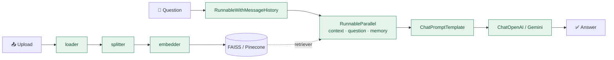

<div align="center">

# 💬 Capstone RAG Chatbot

**Multi-provider Retrieval-Augmented Generation assistant with hybrid conversational memory — built on 🦜🔗 LangChain.**


### 📘 Documentation

| [📄 **Download PDF**](docs/Project_Documentation.pdf) | [📝 Read on GitHub](docs/Project_Documentation.md) | [🌐 HTML edition](docs/Project_Documentation.html) |
|:---:|:---:|:---:|

</div>

---

## ✨ Features

| | Feature | LangChain component |
|---|---|---|
| 📂 | Ingest PDF, DOCX, TXT/MD and web pages | `Document` |
| ✂️ | Recursive chunking with overlap + chunk metadata | `RecursiveCharacterTextSplitter` |
| 🧠 | OpenAI **or** Gemini embeddings (config switch) | `OpenAIEmbeddings`, `GoogleGenerativeAIEmbeddings` |
| 🗄️ | Local **FAISS** or cloud **Pinecone** vector store | `FAISS`, `PineconeVectorStore` |
| 🔎 | Base similarity or **Multi-Query** retrieval | `as_retriever`, `MultiQueryRetriever` |
| 🔗 | Hybrid RAG chain composed with **LCEL** | `RunnableParallel`, `RunnableLambda`, `ChatPromptTemplate` |
| 💭 | Per-session **summary + rolling-window** memory | `ConversationSummaryMemory`, `RunnableWithMessageHistory` |
| 👥 | Multi-chat Streamlit UI with per-chat LLM and memory toggle | — |

## 🏗️ Architecture



## 🚀 Quick Start

```bash
python -m venv .venv
.venv\Scripts\activate                 # macOS/Linux: source .venv/bin/activate
pip install -r requirements.txt
copy env-sample.txt config\.env        # macOS/Linux: cp env-sample.txt config/.env  → add your API keys
streamlit run app/streamlit_app.py     # run from the project root
```

Upload a document in the sidebar to build the index, then start chatting.

## 📁 Project Layout

```text
app/          Streamlit UI + pipeline orchestration
modules/      Core RAG library: loader · splitter · embedder · retriever · rag_chain · memory · utils
config/       config.json (settings) + .env (API keys)
data/         sample_docs/ and uploaded_docs/
notebooks/    RAG_Debugging_Notebook.ipynb — step-by-step test harness
docs/         Full technical documentation (MD · HTML · PDF)
```

See the **[full documentation](docs/Project_Documentation.md)** for the architecture, workflow, module-by-module reference, LangChain usage map, configuration reference and engineering review.
