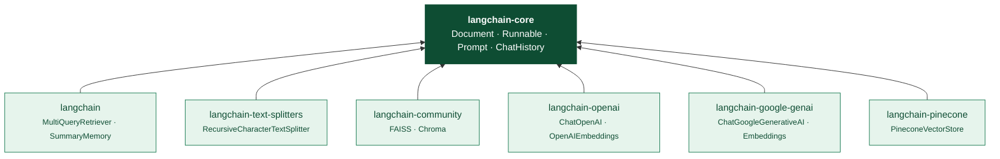
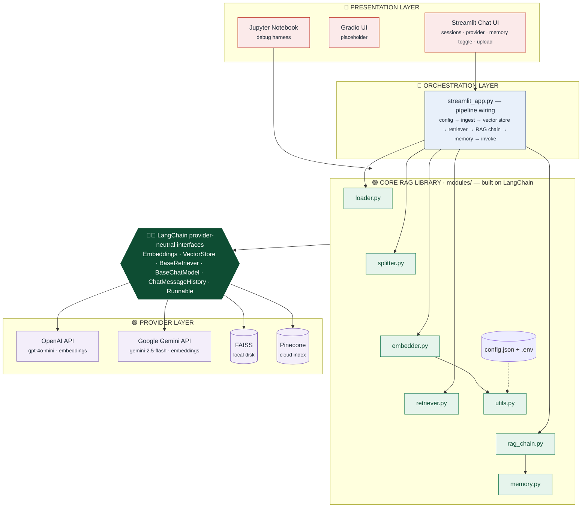
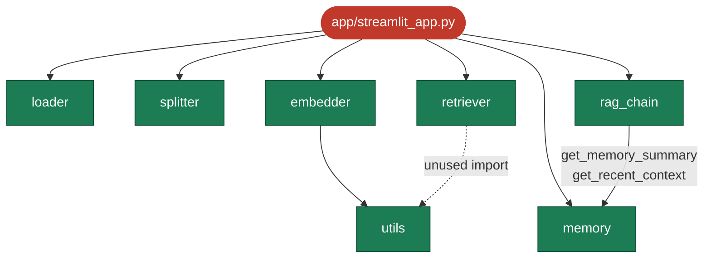
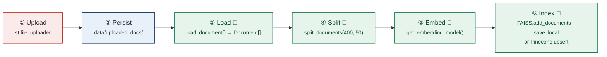
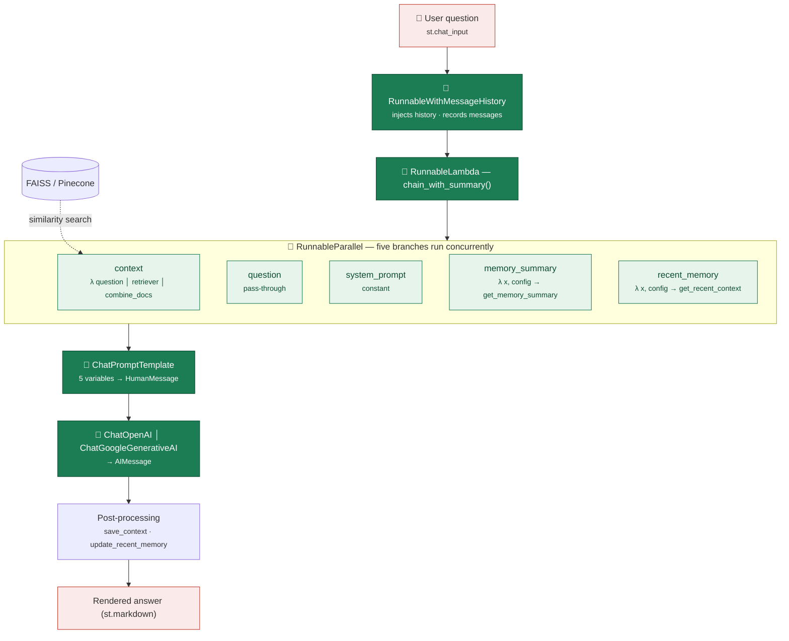
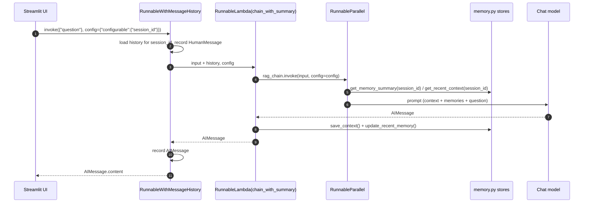

<div align="center">

# 🦜🔗 Capstone RAG Chatbot — Technical Documentation

**A multi-provider Retrieval-Augmented Generation assistant with hybrid conversational memory,<br/>built on the LangChain framework and the LangChain Expression Language (LCEL).**


<br/>


📄 **[Download the full PDF edition](./Project_Documentation.pdf)** &nbsp;·&nbsp; 🌐 [HTML edition](./Project_Documentation.html)

*Revision 1.0 · October 2026 · IIT Patna — Module 5 Capstone*

</div>

> [!TIP]
> **How to read this document.** Every place where the LangChain framework is used is marked with 🟢 **LangChain** or a *“🦜🔗 LangChain in action”* callout. Code references use `file:line` (e.g. `modules/rag_chain.py:76`).

---

## 📑 Table of Contents

1. [Executive Summary](#1-executive-summary)
2. [Technology Stack](#2-technology-stack)
3. [Project Structure](#3-project-structure)
4. [System Architecture](#4-system-architecture)
5. [End-to-End Workflow](#5-end-to-end-workflow)
6. [LangChain Framework Usage](#6-langchain-framework-usage)
7. [Module Reference](#7-module-reference)
8. [Configuration Reference](#8-configuration-reference)
9. [Installation & Operation](#9-installation--operation)
10. [Engineering Review](#10-engineering-review)
11. [Glossary](#11-glossary)

---

## 1. Executive Summary

### 1.1 Purpose

The **Capstone RAG Chatbot** is a document question-answering assistant. Users upload PDF, DOCX or TXT files (or point the loader at a web URL); the application splits each document into overlapping chunks, converts the chunks into vector embeddings, and stores them in a vector database. When a user asks a question, the most relevant chunks are retrieved and passed — together with a running summary of the conversation and the last few exchanges — to a Large Language Model (LLM), which writes a grounded answer.

The whole pipeline is assembled from **LangChain** building blocks. LangChain supplies the common data model (`Document`), provider-neutral interfaces for embeddings, vector stores, retrievers and chat models, and the **LangChain Expression Language (LCEL)**, which the project uses to compose those parts into one runnable chain with per-session memory.

### 1.2 Key Capabilities

| Capability | Description | Enabled by |
|---|---|---|
| **Multi-format ingestion** | Loads `.txt`, `.md`, `.pdf` (page by page), `.docx` and live web pages into a common document format. | 🟢 `Document` · pypdf · python-docx · BeautifulSoup |
| **Smart chunking** | Recursive, structure-aware splitting with overlap, with the chunk position kept in each chunk's metadata. | 🟢 `RecursiveCharacterTextSplitter` |
| **Pluggable embeddings** | Switch between OpenAI and Google Gemini embedding models through one setting in `config.json`. | 🟢 `OpenAIEmbeddings`, `GoogleGenerativeAIEmbeddings` |
| **Local or cloud vector store** | Saves a FAISS index to disk, or uses a serverless/pod Pinecone index. Detects the embedding dimension and checks it against an existing index. | 🟢 `FAISS`, `PineconeVectorStore` |
| **Two retrieval strategies** | Plain top-k similarity search, or a *Multi-Query* retriever that rewrites the question into several variants to improve recall. | 🟢 `VectorStoreRetriever`, `MultiQueryRetriever` |
| **Swappable LLM per chat** | Each chat session can choose OpenAI GPT-4o-mini or Gemini 2.5 Flash at runtime. | 🟢 `ChatOpenAI`, `ChatGoogleGenerativeAI` |
| **Hybrid conversational memory** | Combines an LLM-written *summary memory* with a rolling window of the last *n* Q&A turns, kept separately for each session. | 🟢 `ConversationSummaryMemory`, `RunnableWithMessageHistory` |
| **Multi-session chat UI** | Streamlit interface with several independent chats, a provider choice and a memory toggle for each chat, and document upload. | Streamlit |

### 1.3 At a Glance

| 🧩 Core modules | 📏 Lines of Python | 🦜 LangChain classes used | 📦 LangChain packages | 🤖 LLM providers | 🗄️ Vector stores |
|:---:|:---:|:---:|:---:|:---:|:---:|
| **7** | **~750** | **16** | **7** | **2** | **2** |

---

## 2. Technology Stack

### 2.1 Stack by Layer

| Layer | Technology | Package (pinned) | Role in the project |
|---|---|---|---|
| **Orchestration** | 🟢 LangChain | `langchain==0.3.25` | Legacy entry points: `MultiQueryRetriever`, `ConversationSummaryMemory`, prompt and runnable re-exports |
| | 🟢 LangChain Core | `langchain-core==0.3.65` | `Document`, Runnables (LCEL), prompts, chat history, `RunnableWithMessageHistory` |
| | 🟢 Text Splitters | `langchain-text-splitters==0.3.8` | `RecursiveCharacterTextSplitter` |
| | 🟢 Community | `langchain-community==0.3.24` | `FAISS` (and `Chroma`) vector-store wrappers |
| **LLM providers** | 🟢 OpenAI integration | `langchain-openai==0.3.18` | `ChatOpenAI`, `OpenAIEmbeddings` |
| | 🟢 Google GenAI integration | `langchain-google-genai>=2.1.5` | `ChatGoogleGenerativeAI`, `GoogleGenerativeAIEmbeddings` |
| **Vector DB** | 🟢 Pinecone integration | `langchain-pinecone==0.2.13` | `PineconeVectorStore` wrapper (brings in the `pinecone` SDK) |
| | FAISS (CPU) | `faiss-cpu==1.8.0.post1` | In-process similarity search engine |
| | Pinecone SDK | `pinecone` (unpinned) | Index admin: `list_indexes`, `create_index`, `describe_index` |
| **Document parsing** | pypdf · python-docx · BeautifulSoup · requests | `pypdf==5.1.0`, `python-docx==1.1.2`, `beautifulsoup4==4.12.3`, `requests==2.32.3` | Text extraction from PDF, Word and HTML pages |
| **Presentation** | Streamlit (Gradio placeholder) | `streamlit==1.39.0`, `gradio==5.9.1` | Chat UI, session management, upload |
| **Configuration** | python-dotenv · JSON | `python-dotenv==1.0.1` | Secrets from `config/.env`; settings from `config/config.json` |
| **Observability** | LangSmith · tiktoken | `langsmith==0.3.45`, `tiktoken==0.7.0` | Tracing (when `LANGCHAIN_TRACING_V2` is set), tokenisation |

### 2.2 The LangChain Package Family

Since version 0.2, LangChain has been split into separate packages. Provider-specific code lives in *partner packages*, while the project's own logic depends only on the stable interfaces in `langchain-core`.



---

## 3. Project Structure

### 3.1 Directory Tree

```text
Capstone-Project-RAG-Application/
├── app/                              # Presentation layer (user interfaces)
│   ├── streamlit_app.py              # ★ Main multi-session chat UI + pipeline orchestration
│   └── gradio_app.py                 # Placeholder for an alternative Gradio UI (empty)
├── config/                           # Runtime configuration
│   ├── config.json                   # Provider, vector-store, retriever, chunking settings
│   └── .env                          # API keys (git-ignored; created from env-sample.txt)
├── data/                             # Source documents
│   ├── sample_docs/                  # Reference corpus used by the notebook
│   │   ├── sample_text.txt           #   scikit-learn article (~6 KB)
│   │   └── sample_text2.txt          #   LLM / LangChain article (~15 KB)
│   └── uploaded_docs/                # Files saved by the Streamlit uploader
├── docs/                             # 📄 This documentation (MD · HTML · PDF)
├── modules/                          # Core RAG library (business logic)
│   ├── __init__.py                   # Marks the folder as a Python package
│   ├── utils.py                      # 🦜 .env loading + embedding-model factory
│   ├── loader.py                     # 🦜 File / URL → LangChain Document
│   ├── splitter.py                   # 🦜 Document → chunks (RecursiveCharacterTextSplitter)
│   ├── embedder.py                   # 🦜 Chunks → FAISS / Pinecone vector store
│   ├── retriever.py                  # 🦜 Vector store → Base / Multi-Query retriever
│   ├── rag_chain.py                  # 🦜 LCEL RAG chain (prompt + LLM + context + memory)
│   └── memory.py                     # 🦜 Hybrid summary + rolling-window session memory
├── notebooks/
│   ├── RAG_Debugging_Notebook.ipynb  # Step-by-step test harness for every module
│   └── vectorstores/openai_faiss_index/   # FAISS index created when running the notebook
├── vectorstores/                     # (runtime) FAISS index created by the app — cwd-relative
├── env-sample.txt                    # Template for config/.env
├── requirements.txt                  # Pinned Python dependencies
├── run_app.bat                       # Windows launcher (placeholder, empty)
├── template.py                       # Scaffolding script that generated this layout
└── README.md                         # Repository landing page
```

### 3.2 Folder Reference

| Folder | Layer | Purpose | Key contents |
|---|---|---|---|
| `app/` | 🔴 UI | Entry points that users interact with. Holds the Streamlit application, which also wires the whole pipeline together. | `streamlit_app.py`, `gradio_app.py` |
| `modules/` | 🔵 Core | Reusable RAG library. Each file covers one pipeline stage (load → split → embed → retrieve → generate → remember). Contains no UI code. | 7 modules + `__init__.py` |
| `config/` | ⚙️ Config | Keeps configuration separate from code: non-secret settings in JSON, secrets in `.env`. | `config.json`, `.env` |
| `data/` | 💾 Data | Raw input documents: a fixed test corpus (`sample_docs`) and every file uploaded through the UI (`uploaded_docs`). | `.txt` samples |
| `notebooks/` | 🧪 Dev/QA | Interactive debugging and testing of each module on its own. | `RAG_Debugging_Notebook.ipynb` |
| `vectorstores/` | 💾 Data | Saved FAISS indexes at `<cwd>/vectorstores/<provider>_<type>_index`. | `index.faiss`, `index.pkl` |
| `docs/` | 📄 Docs | This documentation in Markdown, HTML and PDF. | `Project_Documentation.*` |

### 3.3 File Reference

| File | LOC | Purpose | LangChain usage |
|---|:-:|---|---|
| `modules/utils.py` | 30 | Loads `config/.env` when imported; factory that returns the configured embedding model. | 🟢 `OpenAIEmbeddings`, `GoogleGenerativeAIEmbeddings` |
| `modules/loader.py` | 62 | Reads TXT/MD/PDF/DOCX files and URLs and converts them to `Document` objects with a `source` metadata field. | 🟢 `Document` |
| `modules/splitter.py` | 16 | Splits documents into overlapping chunks and records `chunk_index` in each chunk's metadata. | 🟢 `RecursiveCharacterTextSplitter`, `Document` |
| `modules/embedder.py` | 156 | Creates or updates a FAISS index on disk, or creates/connects to a Pinecone index (with dimension checking) and upserts the chunks. | 🟢 `FAISS`, `PineconeVectorStore` |
| `modules/retriever.py` | 31 | Wraps the vector store in a retriever — either plain similarity search or LLM-powered multi-query. | 🟢 `as_retriever`, `MultiQueryRetriever`, chat models |
| `modules/rag_chain.py` | 95 | Builds the LCEL chain: parallel context + memory gathering → prompt → chat model. | 🟢 `ChatPromptTemplate`, `RunnableParallel`, `RunnableLambda`, chat models |
| `modules/memory.py` | 112 | Per-session message history, summary memory and a rolling window of recent turns; wraps the chain so memory is updated after each turn. | 🟢 `InMemoryChatMessageHistory`, `ConversationSummaryMemory`, `RunnableWithMessageHistory` |
| `modules/__init__.py` | 0 | Package marker. | — |
| `app/streamlit_app.py` | 181 | UI + orchestration: sessions, upload & ingestion, building the chain, chat loop. | Uses the chain via `.invoke(..., config={"configurable": {...}})` |
| `app/gradio_app.py` | 0 | Reserved for a Gradio front end (not implemented). | — |
| `config/config.json` | 35 | Runtime settings. | Selects which LangChain integrations are created |
| `env-sample.txt` | 5 | Template listing the API keys needed in `config/.env`. | — |
| `requirements.txt` | 44 | Pinned dependency list for a reproducible environment. | Declares 7 LangChain packages |
| `template.py` | 68 | Scaffolding script that creates the folders and empty files. | — |
| `notebooks/RAG_Debugging_Notebook.ipynb` | 10 cells | Runs load → split → embed → search → retrieve → chain + memory one step at a time. | Calls every LangChain-backed module |
| `run_app.bat` | 0 | Reserved Windows launcher (empty). | — |

---

## 4. System Architecture

### 4.1 Layered Architecture

The system has four layers. The **presentation layer** handles user interaction. The **orchestration layer** (the body of `streamlit_app.py`) calls the pipeline stages in order. The **core RAG library** (`modules/`) contains one module per stage. The **provider layer** holds the external AI services and vector databases, reached only through LangChain's provider-neutral interfaces.



### 4.2 Component Responsibilities

| Component | Input | Output | Responsibility |
|---|---|---|---|
| **Loader** | File path or URL (`str`) | `List[Document]` | Turns any supported source into plain text plus `source` metadata. PDFs produce one Document per page. |
| **Splitter** | `List[Document]` | `List[Document]` (chunks) | Produces chunks small enough to embed and retrieve, with overlap so meaning is not cut off at chunk edges. |
| **Embedder** | Chunks + config | `VectorStore` | Embeds chunks and saves them to FAISS or Pinecone; loads an existing index and adds new chunks to it. |
| **Retriever** | `VectorStore` + config | `BaseRetriever` | Returns the top-k most relevant chunks for a query (optionally widened by multi-query rewriting). |
| **RAG Chain** | Retriever + config | LCEL `Runnable` | Gathers context and memory in parallel, fills the prompt, calls the chat model. |
| **Memory** | RAG chain + session id | `RunnableWithMessageHistory` | Records every turn, keeps the summary up to date, maintains the recent-turn window, and keeps sessions separate. |
| **Utils** | Provider name | `Embeddings` | Loads secrets and returns the matching embedding model. |
| **UI / Orchestrator** | User actions | Rendered chat | Manages chat sessions and per-session settings, ingests uploads, calls the chain. |

### 4.3 Design Principles

| Principle | How the project applies it |
|---|---|
| 🔌 **Provider-neutral interfaces** | Every external service is accessed through a LangChain base class (`Embeddings`, `VectorStore`, `BaseChatModel`, `BaseRetriever`). Switching OpenAI ↔ Gemini or FAISS ↔ Pinecone means changing a config value — the downstream code stays the same. |
| ⚙️ **Configuration-driven** | `config.json` decides which embedding provider, vector store, retriever and LLM are used; `.env` holds the secrets. Factory functions read the config and build the matching objects. |
| 🔗 **Composition with LCEL** | The chain is built with the `\|` operator and a `RunnableParallel` map. Every stage is a `Runnable`, so it supports `invoke` / `batch` / `stream` and is traced automatically in LangSmith. |
| 🧩 **One module per pipeline stage** | Each stage is a separate module with a small functional API, so the notebook can test each stage independently and any new front end can reuse the library. |
| 👥 **Session isolation** | All memory stores are dictionaries keyed by a session UUID, and the session id is passed through LangChain's `configurable` runtime config. |
| ♻️ **Incremental indexing** | An existing FAISS index is loaded and new chunks are added with `add_documents`; Pinecone indexes are created once and later uploads are upserted. |

### 4.4 Module Dependency Graph



---

## 5. End-to-End Workflow

The application has two pipelines: an **ingestion pipeline** that runs when a document is uploaded, and a **question-answering pipeline** that runs for every chat message. Both run inside Streamlit's top-to-bottom script execution model (section 5.3).

### 5.1 Ingestion Pipeline (Indexing)



| # | Stage | Code | What happens |
|:-:|---|---|---|
| 1 | Upload | `streamlit_app.py:102` | User selects a file; Streamlit holds it in memory as an `UploadedFile`. |
| 2 | Persist | `streamlit_app.py:113-118` | File bytes are written to `data/uploaded_docs/<name>`. |
| 3 | Load 🟢 | `loader.load_document` | Chooses a parser by extension/URL and returns `Document(page_content, metadata={"source": ...})` objects. |
| 4 | Split 🟢 | `splitter.split_documents` | `RecursiveCharacterTextSplitter(400, 50)` splits each document and adds `chunk_index` to the metadata. |
| 5 | Embed 🟢 | `utils.get_embedding_model` | Creates `OpenAIEmbeddings` or `GoogleGenerativeAIEmbeddings` based on `embedding_provider`. |
| 6 | Index 🟢 | `embedder.build_or_update_vectorstore` | FAISS: `load_local` + `add_documents` (or `from_documents`) → `save_local`. Pinecone: create/verify the index → `PineconeVectorStore.from_documents`. |

### 5.2 Question-Answering Pipeline (Retrieval + Generation)



| # | Step | Detail |
|:-:|---|---|
| 1 | Invoke with session | `rag_chain_with_memory.invoke({"question": prompt}, config={"configurable": {"session_id": sid}})` — `streamlit_app.py:168` |
| 2 | History injection | `RunnableWithMessageHistory` loads the session's `InMemoryChatMessageHistory`, adds it to the input as `history`, and records the human message. |
| 3 | Wrapper lambda | `chain_with_summary(input_data, config)` calls the inner RAG chain and passes the *same* config on, so the session id reaches the inner branches. |
| 4 | Parallel fan-out | `RunnableParallel` runs five branches concurrently in a thread pool. |
| 5 | Retrieval | The retriever embeds the question and returns the k nearest chunks; `combine_docs` joins them with blank lines (or returns *“No relevant context found.”*). |
| 6 | Prompt formatting | `ChatPromptTemplate.from_template` fills the five variables into a single human message. |
| 7 | Generation | The chat model chosen for the session produces an `AIMessage`. |
| 8 | Memory update | The summary memory is updated (LLM call), the turn is added to the rolling window; `RunnableWithMessageHistory` records the AI message. |
| 9 | Render | The UI reads `response.content`, displays it, and adds it to the session's visible chat history. |

### 5.3 Streamlit Run Lifecycle

Streamlit runs `streamlit_app.py` from top to bottom on **every** user interaction (button click, toggle, chat message):

| Order | Phase | Lines | Behaviour on each rerun |
|:-:|---|:-:|---|
| 1 | Bootstrap | 1–23 | Adds the project root to `sys.path`, imports modules (the first import of `utils` loads `.env`), sets the page config, reads `config.json`. |
| 2 | Session state init | 27–57 | Creates `chat_sessions` / `active_session` once; **➕ New Chat** adds a UUID-keyed session. |
| 3 | Sidebar controls | 60–104 | Session selector, per-session LLM provider and memory toggle, file uploader. |
| 4 | Ingestion | 111–124 | Runs whenever the uploader holds a file (see finding **F-01**). |
| 5 | Backend build | 129–144 | Loads the vector store (`docs=[]`), builds the retriever, applies the session's provider, builds the RAG chain and memory wrapper. Errors stop the page. |
| 6 | Chat render | 150–182 | Shows earlier messages; on new input, calls the chain and adds both messages to the session history. |

---

## 6. LangChain Framework Usage

### 6.1 LangChain Usage Map

| # | LangChain class / API | Import path | Used in | What it does in this project |
|:-:|---|---|---|---|
| 1 | `Document` | `langchain_core.documents` | loader:10 · splitter:16 · embedder | The standard data unit: `page_content` + `metadata`. Every stage takes and returns Documents. |
| 2 | `RecursiveCharacterTextSplitter` | `langchain_text_splitters` / `langchain.text_splitter` | splitter:8 | Splits text on `\n\n`, `\n`, space, then characters until each chunk is within `chunk_size`. |
| 3 | `OpenAIEmbeddings` | `langchain_openai` | utils:23 | Converts text to vectors with OpenAI's embedding API (default model, 1536-dim). |
| 4 | `GoogleGenerativeAIEmbeddings` | `langchain_google_genai` | utils:29 | Converts text to vectors with a Gemini embedding model. |
| 5 | `FAISS` | `langchain_community.vectorstores` | embedder:64-79 | `from_documents`, `load_local`, `add_documents`, `save_local`, `similarity_search`. |
| 6 | `Chroma` | `langchain_community.vectorstores` | embedder:13 | Imported for future local-store support; not used yet. |
| 7 | `PineconeVectorStore` | `langchain_pinecone` | embedder:148 | `from_documents` embeds and upserts chunks into a Pinecone index/namespace. |
| 8 | `VectorStore.as_retriever()` | `langchain_core.vectorstores` | retriever:15,28 | Wraps a store in a `VectorStoreRetriever` (a Runnable) with `search_kwargs={"k": 3}`. |
| 9 | `MultiQueryRetriever` | `langchain.retrievers` | retriever:27 | Uses an LLM to write alternative phrasings of the question, retrieves for each, and returns the de-duplicated union. |
| 10 | `ChatOpenAI` | `langchain_openai` | rag_chain:22 · retriever:21 · memory:30 | Chat model for answers (gpt-4o-mini, streaming), query rewriting and summarisation. |
| 11 | `ChatGoogleGenerativeAI` | `langchain_google_genai` | rag_chain:28 · retriever:23 | Gemini 2.5 Flash chat model, used when `llm_provider="gemini"`. |
| 12 | `ChatPromptTemplate` | `langchain.prompts` (→ core) | rag_chain:46 | Template with five variables, turned into chat messages. |
| 13 | `RunnableParallel` | `langchain.schema.runnable` (→ core) | rag_chain:77 | Runs the five input branches concurrently and returns a dict. |
| 14 | `RunnableLambda` | `langchain.schema.runnable` (→ core) | rag_chain:79-87 · memory:94 | Turns plain Python functions into Runnables; functions that take a `config` parameter receive the runtime config. |
| 15 | `InMemoryChatMessageHistory` | `langchain_core.chat_history` | memory:23 | In-process list of `HumanMessage`/`AIMessage` objects for each session. |
| 16 | `ConversationSummaryMemory` | `langchain.memory` | memory:29 | Keeps an LLM-generated running summary of the conversation. |
| 17 | `RunnableWithMessageHistory` | `langchain_core.runnables.history` | memory:96 | Wraps a Runnable so each call reads and writes a session-scoped chat history. |
| 18 | `PromptTemplate`, `LLMChain` | `langchain.prompts`, `langchain.chains` | retriever:2-3 | Imported but unused (left over from an earlier version). |

### 6.2 LangChain Concepts Explained in Project Context

<details open>
<summary><b>6.2.1 Document — the common data unit</b></summary>

A `Document` is a small object with two fields: `page_content: str` and `metadata: dict`. All loaders produce Documents, the splitter turns one Document into many, and the vector store keeps the metadata next to each vector so retrieved chunks can be traced back to their source file and page.

```python
# loader.py:10 — the factory every loader goes through
def text_to_doc(text: str, source: str = "inline") -> Document:
    return Document(page_content = text, metadata = {"source": source})
```
</details>

<details open>
<summary><b>6.2.2 Text Splitters — chunking for retrieval</b></summary>

Embedding models have input limits, and retrieval works better when each chunk covers one idea. `RecursiveCharacterTextSplitter` tries separators in order `["\n\n", "\n", " ", ""]`: it first splits on paragraphs, splits further only where a piece is still larger than `chunk_size`, then merges small pieces back up to the limit while keeping `chunk_overlap` characters shared between neighbouring chunks.
</details>

<details open>
<summary><b>6.2.3 Embeddings — the provider-neutral vector interface</b></summary>

Both `OpenAIEmbeddings` and `GoogleGenerativeAIEmbeddings` implement the `Embeddings` interface: `embed_documents(list[str])` for indexing and `embed_query(str)` for searching. `embedder.py` uses this interface to measure the vector size (`len(embed_documents(["Hello world!"])[0])`) before creating a Pinecone index.
</details>

<details open>
<summary><b>6.2.4 Vector Stores — FAISS and Pinecone behind one interface</b></summary>

| Operation | FAISS (local) | Pinecone (cloud) |
|---|---|---|
| Create from chunks | `FAISS.from_documents(docs, emb)` | `PineconeVectorStore.from_documents(docs, embedding=emb, index_name, namespace)` |
| Load existing | `FAISS.load_local(dir, embeddings, allow_dangerous_deserialization=True)` | Index already exists on the server — `from_documents` connects to it |
| Add new chunks | `vectorstore.add_documents(docs)` | Upsert happens inside `from_documents` |
| Persist | `save_local(dir)` → `index.faiss` + `index.pkl` | Automatic (managed service) |
| Search | `similarity_search(query, k)` / `as_retriever()` | same API |

> [!WARNING]
> **`allow_dangerous_deserialization=True`** — FAISS saves its docstore with Python `pickle`. LangChain requires this flag as an explicit acknowledgement, because loading a pickle file from an untrusted source can execute arbitrary code. That is acceptable here because the index is always created locally by the application. Never load an `index.pkl` received from someone else.
</details>

<details open>
<summary><b>6.2.5 Retrievers — from vectors to relevant chunks</b></summary>

A retriever is any Runnable that takes a query string and returns `List[Document]`. Because it is a Runnable, it can be placed directly in an LCEL pipe (`... | retriever | ...`).

| Retriever | Construction | Trade-off |
|---|---|---|
| **Base** | `vectorstore.as_retriever(search_kwargs={"k": 3})` | One embedding call, no LLM call — fast and inexpensive. |
| **MultiQuery** | `MultiQueryRetriever.from_llm(retriever, llm)` | The LLM writes alternative phrasings; results are merged and de-duplicated. Better recall, at the cost of an extra LLM call and several searches. |
</details>

<details open>
<summary><b>6.2.6 Chat Models — interchangeable LLMs</b></summary>

`ChatOpenAI` and `ChatGoogleGenerativeAI` both implement `BaseChatModel`: they take messages (or a `PromptValue`) and return an `AIMessage`. `build_rag_chain` chooses one based on `llm_provider`; the rest of the chain is identical for both. `streaming=True` is set so a later UI change can use `chain.stream()` to show tokens as they arrive.
</details>

<details open>
<summary><b>6.2.7 Prompt Templates</b></summary>

`ChatPromptTemplate.from_template(...)` creates a template containing a single human message with placeholders `{system_prompt}`, `{memory_summary}`, `{recent_memory}`, `{context}` and `{question}` — exactly the keys the preceding `RunnableParallel` returns.
</details>

<details open>
<summary><b>6.2.8 LCEL Runnables — the composition layer</b></summary>

| Primitive | Semantics | Where used |
|---|---|---|
| `a \| b` (RunnableSequence) | Passes the output of `a` as the input of `b`. The combined object is itself a Runnable. | context branch; `parallel \| prompt \| llm` |
| `RunnableParallel({...})` | Sends the same input to every branch, runs them concurrently, and returns a dict of their outputs. | `rag_chain.py:77` |
| `RunnableLambda(fn)` | Wraps a Python function. If `fn` has a parameter named `config`, LangChain passes in the current `RunnableConfig`. | extraction lambdas, memory lookups, `chain_with_summary` |
| `RunnableWithMessageHistory` | Adds stored history to the input, runs the wrapped Runnable, saves the new messages, keyed by `configurable.session_id`. | `memory.py:96` |
</details>

<details open>
<summary><b>6.2.9 Memory — chat history and summary memory</b></summary>

`InMemoryChatMessageHistory` is the low-level store (a list of messages). `ConversationSummaryMemory` is a higher-level helper from the classic `langchain.memory` API that shares the same history and uses an LLM to keep a short running summary up to date. The project adds its own *rolling window* of the last *n* turns, giving **hybrid memory**: the summary keeps long-range context compact, and the window keeps the exact wording of the latest exchanges.
</details>

### 6.3 Anatomy of the LCEL RAG Chain

```python
# modules/rag_chain.py · lines 76–92
rag_chain = (
    RunnableParallel(
        {
            "context":  RunnableLambda(lambda x: x["question"]) | retriever | RunnableLambda(combine_docs),
            "question": RunnableLambda(lambda x: x["question"]),
            "system_prompt": RunnableLambda(lambda _: system_prompt),
            "memory_summary": RunnableLambda(
                lambda x, config: get_memory_summary(config["configurable"]["session_id"])
            ),
            "recent_memory": RunnableLambda(
                lambda x, config: get_recent_context(config["configurable"]["session_id"])
            ),
        }
    )
    | prompt     # ChatPromptTemplate  : dict  → ChatPromptValue
    | llm        # ChatOpenAI / Gemini : prompt → AIMessage
)
```

| Stage | Input type | Output type | Notes |
|---|---|---|---|
| Chain input | — | `{"question": str, "history": [...]}` | `history` is added by `RunnableWithMessageHistory`; the prompt does not use it. |
| RunnableParallel | input dict | `{context, question, system_prompt, memory_summary, recent_memory}` | Branches run concurrently. |
| prompt | 5-key dict | `ChatPromptValue` (1 HumanMessage) | Placeholders filled with plain string formatting. |
| llm | `ChatPromptValue` | `AIMessage` | `.content` holds the answer text. |

### 6.4 How the Session ID Reaches the Memory Lookups

The session id is never part of the chain's *input data*; it travels in LangChain's **runtime config**, which LCEL automatically passes down to every nested Runnable:



> [!NOTE]
> **🦜🔗 LangChain in action — why config, not input?** Keeping the session id in `configurable` leaves the chain's input contract simple (`{"question": ...}`). Callbacks and tracing tags travel the same way, so in LangSmith every step of a session's run appears under one trace with the session metadata attached.

---

## 7. Module Reference

### 7.1 `modules/utils.py` — Environment & Embedding Factory

**Purpose.** When first imported, resolves `<project>/config/.env` relative to its own location (so it works from any working directory), loads it with `python-dotenv`, and prints the path it loaded.

| | |
|---|---|
| **Imports** | `os`, `dotenv.load_dotenv`, 🟢 `OpenAIEmbeddings`, 🟢 `GoogleGenerativeAIEmbeddings` |
| **Side effects at import** | Loads `.env` into the process environment; prints `Loaded .env from: …` |
| **Used by** | `embedder.py` (and imported, unused, by `retriever.py`) |

#### `get_embedding_model(provider: str) -> Embeddings` · line 15

| `provider` | Env var required | Returns |
|---|---|---|
| `"openai"` | `OPENAI_API_KEY` | `OpenAIEmbeddings(api_key=…)` — library default model |
| `"gemini"` / `"google"` | `GOOGLE_API_KEY` | `GoogleGenerativeAIEmbeddings(model="models/gemini-embedding-2", google_api_key=…)` |
| anything else | — | raises `ValueError("Unsupported embedding provider")` |

> [!NOTE]
> **🦜🔗 LangChain in action** — a *factory over the `Embeddings` interface*. Callers receive an object with `embed_documents` / `embed_query` and do not need to know which vendor is behind it — this is what lets `embedder.py` handle both providers with the same code.

### 7.2 `modules/loader.py` — Document Loading

**Purpose.** Converts files and web pages into LangChain `Document` objects. The project uses small custom loaders built on pypdf, python-docx and BeautifulSoup, but still outputs the standard `Document` type so the rest of the pipeline works unchanged.

| Function | Line | Returns | Behaviour |
|---|:-:|---|---|
| `text_to_doc(text, source="inline")` | 10 | `Document` | Builds a 🟢 `Document` with `metadata={"source": source}`. Every loader uses this. |
| `load_txt(path)` | 13 | `[Document]` | Raises `FileNotFoundError` if missing; reads UTF-8 with `errors="ignore"`; source = absolute path. |
| `load_pdf(path)` | 20 | `[Document] × pages` | `pypdf.PdfReader`; **one Document per page**; source = `"<abs path>: page: N"`. |
| `load_docx(path)` | 28 | `[Document]` | `python-docx`; keeps non-blank paragraphs joined by `\n\n` (tables/headers not extracted). |
| `load_url(url)` | 34 | `[Document]` | `requests.get` (15 s timeout) → BeautifulSoup; extracts text from `p, h1–h3, li`; source = URL. |
| `load_document(path_or_url)` | 45 | `[Document]` | **Dispatcher.** `http(s)://` → URL; otherwise routes by extension (`.txt`, `.pdf`, `.docx/.docs/.doc`), falling back to plain text, otherwise `ValueError`. |

### 7.3 `modules/splitter.py` — Chunking

#### `split_documents(docs, chunk_size=500, chunk_overlap=100) -> List[Document]` · line 7

1. Creates a 🟢 `RecursiveCharacterTextSplitter(chunk_size, chunk_overlap)`.
2. For each input document, calls `splitter.split_text(doc.page_content)`.
3. For each chunk, copies the parent metadata and adds `chunk_index` (0-based).
4. Returns a flat list of new `Document` chunks.

| Caller | chunk_size | chunk_overlap |
|---|:-:|:-:|
| Function default | 500 | 100 |
| Streamlit app (`streamlit_app.py:121`) | 400 | 50 |
| Notebook | 200 | 20 / 40 |

> [!NOTE]
> **🦜🔗 LangChain in action** — Using `split_text` and rebuilding Documents by hand gives full control over metadata: every chunk carries `source` + `chunk_index`, so a retrieved chunk can be traced to an exact position in its source.

### 7.4 `modules/embedder.py` — Vector Store Management

#### `build_or_update_vectorstore(docs, config, persist_dir=None) -> VectorStore` · line 23

| Parameter | Meaning |
|---|---|
| `docs` | Chunks to add. Pass `[]` to only load the existing index (what the app does on every rerun). |
| `config` | Parsed `config.json`; reads `embedding_provider` and `vector_store.type` / `vector_store.cloud.*`. |
| `persist_dir` | FAISS folder; default `<cwd>/vectorstores/<provider>_<type>_index`. |

**FAISS branch (lines 53–84)**

| State | Action |
|---|---|
| `index.faiss` exists | 🟢 `FAISS.load_local(..., allow_dangerous_deserialization=True)`; if `docs` → `add_documents(docs)` |
| No index, `docs` empty | Raises `ValueError("No documents provided and FAISS index not found.")` |
| No index, `docs` provided | 🟢 `FAISS.from_documents(docs, embedding_model)` |
| Always | `save_local(persist_dir)`, then returns the store |

**Pinecone branch (lines 89–157)**

1. Reads `PINECONE_API_KEY` (required) and region from `PINECONE_ENV` → fallback `vector_store.cloud.environment`.
2. Index name = `<cloud.index_name>-<provider>` (e.g. `rag-assistant-index-openai`), so each embedding provider gets its own index.
3. **Detects the embedding dimension** by embedding `"Hello world!"`.
4. If missing: creates the index (`metric="cosine"`) — `PodSpec` for `*-free`/`*-starter`, else `ServerlessSpec(cloud="aws", region=env)`.
5. If existing: `describe_index` and **checks that the dimension matches** (a mismatch raises `ValueError`).
6. 🟢 `PineconeVectorStore.from_documents(docs, embedding, index_name, namespace, pinecone_api_key)` — connects and upserts.

> [!NOTE]
> **🦜🔗 LangChain in action**
> - **Two backends, one return type** — both return a LangChain `VectorStore`, so `retriever.py` calls `.as_retriever()` the same way for either.
> - **Two SDKs working together** — the raw `pinecone` SDK handles *index administration*; LangChain's `PineconeVectorStore` handles the *data plane* (embed + upsert + query).
> - **Embedding is done inside the store** — `from_documents` / `add_documents` call `embed_documents` internally.

### 7.5 `modules/retriever.py` — Retrieval Strategy

#### `get_retriever(vectorstore, config) -> BaseRetriever` · line 9

| `retriever_type` | Construction | Characteristics |
|---|---|---|
| `"base"` *(default)* | 🟢 `vectorstore.as_retriever(search_kwargs={"k": 3})` | Similarity search, top-3 chunks. 1 embedding call per question. |
| `"multiquery"` | 🟢 `MultiQueryRetriever.from_llm(retriever=…, llm=…)` with `ChatOpenAI("gpt-4o-mini", T=0)` or `ChatGoogleGenerativeAI("gemini-2.5-flash")` | The LLM writes alternative phrasings of the question; the union of their results is returned. Better recall, higher latency and cost. |
| other | — | `ValueError("Unsupported retriever_type")` |

> [!NOTE]
> **🦜🔗 LangChain in action** — `MultiQueryRetriever.from_llm` builds an internal `prompt | llm | line-parser` LCEL chain that produces the alternative questions, runs the base retriever for each, and returns the unique documents. It is a `BaseRetriever`, so it fits into the RAG chain exactly where the base retriever would.

### 7.6 `modules/rag_chain.py` — The Hybrid RAG Chain

#### `build_rag_chain(retriever, config) -> Runnable[dict, AIMessage]` · line 14

| Config key | Default | Effect |
|---|---|---|
| `llm_provider` | `"openai"` | Chooses `ChatOpenAI` or `ChatGoogleGenerativeAI`; anything else → `ValueError` |
| `llm_temperature` | `0.3` | Sampling temperature |
| `openai_model` | `"gpt-4o-mini"` | OpenAI chat model |
| `gemini_model` | `"gemini-2.5-flash"` | Gemini chat model |

| Internal element | Description |
|---|---|
| `system_prompt` | Role instructions telling the model it has a conversation summary and the most recent turns, and should use both. |
| `prompt` | 🟢 `ChatPromptTemplate`: System Prompt · Conversation Summary Memory · Recent Chat History · Retrieved Context · User Question, followed by guidance to rely on memory for meta-questions. |
| `combine_docs(docs)` | Joins the chunk texts with blank lines, or returns *“No relevant context found.”* when nothing was retrieved. |
| `rag_chain` | `RunnableParallel(5 branches) \| prompt \| llm` — see §6.3. |

> [!IMPORTANT]
> **🦜🔗 LangChain in action — the centre of the project.** A single declarative LCEL expression combines **retrieval**, **memory** (config-aware `RunnableLambda`s), **prompting** and **generation**. The result supports `invoke`/`batch`/`stream` and their async versions, and it is traced in LangSmith with no extra code.

### 7.7 `modules/memory.py` — Hybrid Session Memory

| Module-level store | Value type | Purpose |
|---|---|---|
| `SESSION_MESSAGE_HISTORY` | 🟢 `InMemoryChatMessageHistory` | Complete list of messages for the session |
| `SESSION_SUMMARY_MEMORY` | 🟢 `ConversationSummaryMemory` | LLM-maintained running summary (gpt-4o-mini, T=0), sharing the history above |
| `SESSION_RECENT_MEMORY` | `list[{"user","ai"}]` | Rolling window of the last *n* (default 2) Q&A pairs |

| Function | Line | Behaviour |
|---|:-:|---|
| `get_session_message_history(session_id)` | 21 | Creates the session's `InMemoryChatMessageHistory` on first use, then returns it. |
| `get_session_summary_memory(session_id)` | 27 | Creates the session's `ConversationSummaryMemory(llm=ChatOpenAI(...), chat_memory=history, return_messages=True)` on first use, then returns it. |
| `get_recent_memory(session_id, n=2)` | 38 | Returns the last *n* stored turns. |
| `update_recent_memory(session_id, user, ai, n=2)` | 44 | Appends `{"user","ai"}` and trims to the last *n*. |
| `get_recent_memory_formatted(session_id, n=2)` | 52 | Formats the window as `User: …\nAssistant: …` blocks. |
| `add_memory_to_chain(rag_chain, session_id, enabled=True, recent_n=2)` | 64 | If `enabled` is false, returns the chain unchanged (stateless). Otherwise wraps it (below). |
| `get_memory_summary(session_id)` | 106 | Returns the current summary text. |
| `get_recent_context(session_id, n=2)` | 111 | Returns the formatted recent window. |

```python
def chain_with_summary(input_data, config=None):
    response = rag_chain.invoke(input_data, config=config)           # 1. run RAG
    summary_memory.save_context({"input": q}, {"output": a})         # 2. update summary (LLM call)
    update_recent_memory(session_id, q, a, n=recent_n)               # 3. update rolling window
    new_summary = summary_memory.predict_new_summary(msgs, old)      # 4. re-summarise (2nd LLM call)
    summary_memory._buffer = new_summary                             #    see finding F-05
    return response

return RunnableWithMessageHistory(
    RunnableLambda(chain_with_summary),
    get_session_history=lambda _: get_session_message_history(session_id),
    input_messages_key="question", history_messages_key="history", output_messages_key=None)
```

> [!NOTE]
> **🦜🔗 LangChain in action**
> - **`RunnableWithMessageHistory`** takes the human message from the `question` key, adds stored history under `history`, and records the returned `AIMessage`.
> - **`ConversationSummaryMemory`** is used only as a *summary engine*: `save_context` / `predict_new_summary` run an internal summarisation prompt through the LLM.
> - **Hybrid design** — the summary provides compressed long-range context; the rolling window keeps the exact wording of the latest turns.

### 7.8 `app/streamlit_app.py` — UI & Orchestration

| Section | Lines | Description |
|---|:-:|---|
| Path bootstrap | 5–7 | Adds the project root to `sys.path` so `modules.*` imports work. |
| Config load | 21–23 | Reads `config/config.json` into `CONFIG`. |
| Session model | 27–57 | `st.session_state.chat_sessions: {uuid: {name, llm_provider, memory_enabled, chat_history}}` + `active_session`. |
| Session selector | 61–79 | A selectbox of session names maps back to the session UUID. |
| Per-session settings | 85–97 | LLM provider (`openai`/`gemini`) and memory toggle, with widget keys unique to each session. |
| Uploader & ingestion | 102–124 | Saves the file → `load_document` → `split_documents(400, 50)` → `build_or_update_vectorstore`. |
| Backend build | 129–144 | Vector store → retriever → session provider → `build_rag_chain` → `add_memory_to_chain`. Errors → `st.error` + `st.stop()`. |
| Chat loop | 150–182 | Shows earlier messages; invokes the chain with `configurable.session_id`; renders `response.content`. |

### 7.9 `template.py` — Project Scaffolding

`create_project_structure()` uses a `dict[folder → items]` to create the folders, sub-folders (entries ending in `/`) and empty files (`pathlib.Path.touch`). Safe to run again: `exist_ok=True`, and `touch` does not truncate existing files.

### 7.10 `notebooks/RAG_Debugging_Notebook.ipynb` — Test Harness

| Cell | Stage tested | What it verifies |
|:-:|---|---|
| 0 | Setup | Adds the parent folder to `sys.path`; imports loader and splitter. |
| 1 | Loader | Loads `sample_text.txt`; prints document count and a preview. |
| 2 | Splitter | Splits with 200 / 20; prints chunk count, first chunk and its metadata. |
| 3–4 | Embeddings | (Commented out) smoke test of `get_embedding_model` for both providers. |
| 5–6 | Vector store | Builds the FAISS index → `notebooks/vectorstores/openai_faiss_index/`. |
| 7 | Similarity search | `vectorstore.similarity_search("Explain scikit-learn in short?", k=2)` |
| 8 | Retriever | `get_retriever(...).invoke(query)` |
| 9 | Chain + memory | Two-turn conversation; the second question (“summarise our conversation in 3 bullet points”) tests that memory works. |

---

## 8. Configuration Reference

### 8.1 `config/config.json`

| Key | Value | Read by | Status / Notes |
|---|---|---|---|
| `llm_provider` | `"openai"` | rag_chain, retriever |  Overridden by each session's sidebar choice |
| `embedding_provider` | `"openai"` | embedder → utils |  `openai` \| `gemini` |
| `vector_store.type` | `"faiss"` | embedder |  `faiss` \| `pinecone` |
| `vector_store.cloud.index_name` | `"rag-assistant-index"` | embedder |  `-<provider>` is appended |
| `vector_store.cloud.namespace` | `"default"` | embedder |  Pinecone namespace |
| `vector_store.cloud.environment` | `"gcp-starter"` | embedder |  Used only if `PINECONE_ENV` is not set |
| `vector_store.local.faiss_path` | `"vectorstores/faiss_index"` | — |  Path derived from the cwd |
| `vector_store.cloud.provider` / `dimension` | `"faiss"` / `1536` | — |  Dimension is detected at runtime |
| `retriever.type` / `top_k` | `"base"` / `3` | — |  Code reads top-level `retriever_type` |
| `prompt.*` | … | — |  Prompt hard-coded |
| `memory.*` | `true` / `5` | — |  Window is `recent_n=2` |
| `chunking.*` | `500` / `100` | — |  App passes 400 / 50 |
| *(absent)* `llm_temperature`, `openai_model`, `gemini_model`, `retriever_type` | — | rag_chain, retriever |  Add at top level to override the code defaults |

### 8.2 Environment Variables (`config/.env`)

| Variable | Required when | Purpose |
|---|---|---|
| `OPENAI_API_KEY` | Always (in practice) | OpenAI embeddings/chat. **Also required for summary memory even when Gemini is selected.** |
| `GOOGLE_API_KEY` | Gemini selected | Gemini chat and/or embeddings |
| `PINECONE_API_KEY` | `vector_store.type = pinecone` | Pinecone authentication |
| `PINECONE_ENV` | Optional | Region (e.g. `us-east-1`); takes precedence over `config.json` |
| `LANGCHAIN_TRACING_V2`, `LANGCHAIN_API_KEY`, `LANGCHAIN_PROJECT` | Optional | Turns on LangSmith tracing of every chain run |

---

## 9. Installation & Operation

```bash
# 1. Create and activate a virtual environment
python -m venv .venv
.venv\Scripts\activate              # Windows   (macOS/Linux: source .venv/bin/activate)

# 2. Install dependencies
pip install -r requirements.txt

# 3. Configure secrets
copy env-sample.txt config\.env     # Windows   (macOS/Linux: cp env-sample.txt config/.env)

# 4. Run from the project root (the FAISS index path is relative to the working directory)
streamlit run app/streamlit_app.py
```

1. On first launch no index exists, so the page shows *“No documents provided and FAISS index not found.”* — upload a document in the sidebar to create it.
2. Ask questions in the chat box. Use **➕ New Chat** for separate conversations, and the sidebar to switch LLM provider or turn memory on/off for each chat.
3. For step-by-step debugging, run `notebooks/RAG_Debugging_Notebook.ipynb` cell by cell.

| Goal | Change |
|---|---|
| Answer with Gemini | Sidebar → *LLM Provider* → `gemini` (per session, no restart) |
| Embed with Gemini | `"embedding_provider": "gemini"` → re-upload documents (a new index is created) |
| Use Pinecone | `"vector_store": {"type": "pinecone", …}` + `PINECONE_API_KEY` (+ `PINECONE_ENV`) |
| Multi-query retrieval | Add top-level `"retriever_type": "multiquery"` |
| Change model / temperature | Add top-level `"openai_model"`, `"gemini_model"`, `"llm_temperature"` |

---

## 10. Engineering Review

A code review carried out while preparing this document found the following issues. None of them stops the main flow (upload → ask → answer) from working.

### 10.1 Findings Register

| ID | Severity | Location | Finding | Recommendation |
|:-:|:-:|---|---|---|
| F-01 | 🔴 High | `streamlit_app.py:111` | Streamlit reruns the script on every interaction and the uploader keeps its file, so the same document is **re-embedded and added to FAISS again on every chat message**. | Record processed files in `st.session_state` and skip files already ingested. |
| F-02 | 🔴 High | `memory.py:30` | Summary memory always uses `ChatOpenAI`; Gemini-only setups fail without an OpenAI key. | Pass the session's chat model into the summary memory. |
| F-03 | 🟠 Medium | `retriever.py:11` | Reads `config["retriever_type"]`, but `config.json` defines `retriever.type` / `top_k`, which are therefore ignored. | Read `config["retriever"]["type"]` and `top_k`. |
| F-04 | 🟠 Medium | `retriever.py:28` | Typo `search_kwards` → the multi-query base retriever ignores k=3 and uses the library default (k=4). | Change it to `search_kwargs`. |
| F-05 | 🟠 Medium | `memory.py:84-87` | `save_context` already updates the summary; the second `predict_new_summary` is an extra LLM call whose result is stored in `_buffer`, a field the class never reads (the real field is `buffer`). | Remove lines 84–87, or assign to `buffer`. |
| F-06 | 🟠 Medium | `memory.py:78 / :96` | `save_context` and `RunnableWithMessageHistory` both write to the same history, so each turn is stored twice. | Give the summary memory its own history object. |
| F-07 | 🟠 Medium | `embedder.py:55` | The FAISS path depends on the working directory, so the notebook and the app use different indexes. | Resolve the path from the project root / use `faiss_path`. |
| F-08 | 🟠 Medium | `streamlit_app.py:129-144` | Vector store, retriever and chain are rebuilt (and FAISS is saved to disk) on every rerun. | Cache them with `@st.cache_resource`. |
| F-09 | 🔵 Low | `config.json` | The `prompt`, `memory`, `chunking` and `retriever` sections are not read. | Read them in the code so `config.json` is the single source of truth. |
| F-10 | 🔵 Low | `loader.py:53` | `"md"` is missing its leading dot; `.doc` cannot be read by python-docx. | Use `".md"`; remove `.doc`/`.docs`. |
| F-11 | 🔵 Low | retriever, splitter, embedder | Unused imports (`LLMChain`, `PromptTemplate`, `get_embedding_model`, `Chroma`) and a duplicate splitter import. | Remove them. |
| F-12 | 🔵 Low | memory, rag_chain, retriever | Old import paths (`langchain.schema.runnable`, `langchain.prompts`); `ConversationSummaryMemory` is deprecated in LangChain 0.3. | Import from `langchain_core.*`; build the summary step as a small LCEL chain. |
| F-13 | 🔵 Low | `streamlit_app.py:108` | The `os.path.join(...)` result is never used. | Delete the line. |
| F-14 | 🔵 Low | `gradio_app.py`, `run_app.bat` | Empty placeholders. | Implement or remove them. |

### 10.2 Recommended Roadmap

| Phase 1 · Correctness | Phase 2 · LangChain modernisation | Phase 3 · Production |
|---|---|---|
| Fix F-01 (re-ingestion) | Move imports to `langchain_core` | Cache resources (F-08) |
| Fix F-03 / F-04 (retriever config) | Replace `ConversationSummaryMemory` with an LCEL summariser | Persistent chat history (Redis / SQL) |
| Fix F-05 / F-06 (memory) | Show answers token by token with `chain.stream()` + `st.write_stream` | Turn on LangSmith tracing & evaluation |
| Use the session's LLM for summaries (F-02) | Return source citations from chunk metadata | Gradio UI + launcher script |

---

## 11. Glossary

| Term | Definition |
|---|---|
| **RAG** | Retrieval-Augmented Generation — retrieving relevant passages from your own data and adding them to the LLM prompt so the answer is based on that data. |
| **LangChain** | Open-source framework that provides standard interfaces and integrations for building LLM applications. |
| **LCEL** | LangChain Expression Language — the `\|`-based way of combining Runnables into chains that support invoke/batch/stream and async. |
| **Runnable** | LangChain's base interface for any step in a chain (prompts, models, retrievers, lambdas, parallel maps). |
| **Document** | LangChain's text container: `page_content` + `metadata`. |
| **Chunk** | A piece of a document produced by a text splitter; the unit that is embedded and retrieved. |
| **Embedding** | A list of numbers (vector) that represents the meaning of a text; similar texts produce nearby vectors. |
| **Vector store** | A database that stores embeddings and finds the nearest ones to a query vector (FAISS, Pinecone). |
| **Retriever** | A Runnable that maps a query string to a list of relevant Documents. |
| **Multi-Query Retrieval** | Using an LLM to rewrite a question in several ways, then merging the results of each search to improve recall. |
| **Summary memory** | An LLM-maintained short summary of a conversation, used to keep long-range context. |
| **Rolling window memory** | The last *n* turns kept word for word, used for short-term context. |
| **RunnableConfig / configurable** | Runtime settings passed alongside a chain's input (e.g. `session_id`, callbacks, tags) and passed down to every nested step. |
| **Namespace (Pinecone)** | A logical partition inside a Pinecone index. |
| **LangSmith** | LangChain's tracing and evaluation platform for inspecting chain runs. |

---

<div align="center">

**Capstone RAG Chatbot — Technical Documentation** · Revision 1.0 · October 2026<br/>
📄 [Download PDF](./Project_Documentation.pdf) · 🌐 [HTML edition](./Project_Documentation.html) · 🏠 [Back to README](../README.md)

</div>
